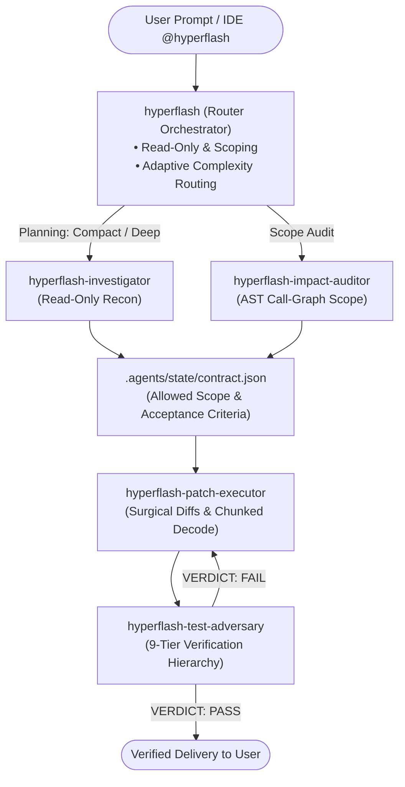

<div align="center">

# ⚡ HyperFlash

### *High-Rigor Multi-Agent Reliability Runtime for Google Antigravity & Gemini*

Turn fast, cost-efficient engines like **Gemini 3.8 Flash** into an enterprise-grade autonomous engineering team.<br/>
**Zero lazy code elision (`// ... rest of code`). Zero ungrounded mutations. Zero premature victories.**

<br/>

[](https://github.com/Virat-Ghatge/hyperflash/stargazers)
[](https://github.com/Virat-Ghatge/hyperflash/network/members)
[](https://github.com/Virat-Ghatge/hyperflash/issues)
[](LICENSE)
[](https://antigravity.google/)
[](https://deepmind.google/technologies/gemini/)
[](https://www.python.org/)
[](CONTRIBUTING.md)

<br/>

[Quick Install](#-instant-30-second-quickstart) • [Why HyperFlash?](#-why-hyperflash) • [How to Use](#-how-to-use-hyperflash) • [Architecture](#-multi-agent-architecture) • [The 8 Invariants](#-the-8-watcher-invariants) • [Governance](#-community--governance)

</div>

---

## 💡 Why HyperFlash?

Fast execution models like **Gemini 3.8 Flash** offer game-changing token generation speeds and fraction-of-a-cent pricing. However, when deployed in autonomous software engineering workflows, unconstrained fast models suffer from predictable, structural failure modes:

* 🚨 **Lazy Truncation Comments:** Under token or context pressure, models substitute large implementation blocks with placeholders like `// ... rest of implementation` or empty `pass` blocks, destroying working code.
* 🚨 **Ungrounded Mutations:** Editing function signatures before verifying upstream repository callers, triggering widespread compilation errors.
* 🚨 **Premature Victory:** Declaring *"I have fixed the issue!"* without ever running the compiler, type checker, or unit tests.
* 🚨 **The `/boost` Quota Drain:** Google Antigravity's default `/boost` mode unconditionally spawns heavy multi-agent swarms even for trivial 2-line typo fixes, burning developer quotas and introducing 60-second latency spikes.

### The HyperFlash Paradigm
**HyperFlash trades parameter scale for deterministic structural scaffolding.** Instead of hoping a larger model behaves reliably, HyperFlash enforces OS-level lifecycle hooks, pre-computed AST symbol graphs, tool-permission asymmetry, and machine-gated verification.

```
┌────────────────────────────────────────────────────────────────────────────────────────┐
│                                 THE HYPERFLASH ADVANTAGE                               │
├──────────────────────────┬───────────────────┬───────────────────┬─────────────────────┤
│ Dimension                │ Vanilla 3.8 Flash │ Native /boost     │ HyperFlash ⚡       │
├──────────────────────────┼───────────────────┼───────────────────┼─────────────────────┤
│ Code Completeness        │ Frequent elision  │ Occasional elision│ 100% Guaranteed (1) │
│ Upstream Caller Tracking │ Unreliable        │ Broad grep scans  │ AST Symbol Graph (2)│
│ Premature Completion     │ Very High         │ Moderate          │ Blocked by Hook (3) │
│ Byte-Identical Loops     │ Common on failure │ Possible          │ SHA-256 Ledger (4)  │
│ Trivial Task Latency     │ 2–4s              │ 30–60s (Swarm)    │ Adaptive Triage (5) │
│ Cost & Quota Footprint   │ Minimal           │ High Token Burn   │ Highly Optimized    │
│ OS Lifecycle Protection  │ None              │ None              │ Native hooks.json   │
└──────────────────────────┴───────────────────┴───────────────────┴─────────────────────┘
(1) PreToolUse hook blocks any edit payload containing truncation or elision comments.
(2) SessionStart hook generates a compact workspace symbol index (.agents/state/symbol_graph.json).
(3) Stop hook denies task completion if files were modified without a subsequent passing test run.
(4) Tool call hashes are recorded in retry_ledger.json; identical retries of failed calls are rejected.
(5) Adaptive complexity routing executes 1-file edits instantly without spawning redundant subagents.
```

---

## 🚀 Instant 30-Second Quickstart

Configure HyperFlash globally in your Antigravity environment (`~/.gemini/config/`).

### Linux & macOS
```bash
git clone https://github.com/Virat-Ghatge/hyperflash.git
cd hyperflash
./install.sh
```

### Windows (PowerShell)
```powershell
git clone https://github.com/Virat-Ghatge/hyperflash.git
cd hyperflash
.\install.ps1
```

> [!TIP]
> **Non-Destructive Guarantee:** HyperFlash's installer merges its lifecycle hooks directly into your existing `hooks.json`. It will **never** overwrite or delete third-party MCP servers, custom agent configurations, or existing hooks.

---

## 💻 How to Use HyperFlash

HyperFlash integrates natively with both the **Antigravity Desktop IDE** and the terminal **`agy` CLI**.

### 1. In the Antigravity Desktop IDE (Recommended)
You can invoke HyperFlash directly inside your conversation prompt box:

* **In-Chat Mention (`@hyperflash`):** Type `@hyperflash` directly in the prompt input followed by your request. Antigravity autocompletes the agent name and immediately routes the turn through the HyperFlash orchestrator:
  ```text
  @hyperflash Refactor src/pipeline.py to add bounded async backpressure and ensure all unit tests pass.
  ```
* **Agent Selector Dropdown:** Click the Agent dropdown above the chat input field and select **`hyperflash`**.
* **Slash Switcher:** Type `/agent hyperflash` in the chat to lock the session to HyperFlash.

### 2. In the Antigravity Terminal CLI (`agy`)
* **Launch an interactive session:**
  ```bash
  agy --agent hyperflash
  ```
* **Execute a single prompt directly:**
  ```bash
  agy --agent hyperflash -i "Fix failing pytest assertions in tests/test_engine.py"
  ```
* **Switch mid-session:** Type `/agent hyperflash` inside any active CLI conversation.

---

## 🏛 Multi-Agent Architecture

HyperFlash enforces strict **tool-permission asymmetry**. The primary orchestrator is stripped of file-writing tools, making it impossible to bypass the verification loop or mutate code without a formal contract:



### Agent Roster & Permission Boundaries

| Agent Name | Role | Permitted Tools | Core Responsibility |
|---|---|---|---|
| **`hyperflash`** | **Orchestrator** | Read, Search, Subagent Hooks | Evaluates task complexity, initializes `contract.json`, and coordinates subagents. Zero write tools. |
| **`hyperflash-investigator`** | **Reconnaissance** | `view_file`, `grep_search` | Inspects target files, identifies relevant tests, and localizes implementation areas. |
| **`hyperflash-impact-auditor`** | **Dependency Auditor** | `view_file`, `symbol_graph` | Traces callers across the repository to lock `allowed_write_scope` before any code changes. |
| **`hyperflash-patch-executor`** | **Implementation** | `replace_file_content` | Applies minimal, surgical diffs. Enforces Chunked Long-Decode and exhaustive static typing. |
| **`hyperflash-reviewer`** | **Code Reviewer** | `view_file`, `run_command` | Audits `git diff` against structural invariants and project conventions (Tier 8 Verification). |
| **`hyperflash-test-adversary`** | **Verification & QA** | `run_command` | Executes compilers, linters, and unit test suites (Tiers 1–6) to produce concrete pass/fail evidence. |

---

## 🛡 The 8 Watcher Invariants

Every file edit and task completion is deterministically governed by OS-level hooks in `~/.gemini/config/hooks.json`:

1. **Ground Before Mutating:** Target files must be viewed via `view_file` in the current session before edits are permitted.
2. **Stay in Declared Scope:** Mutations outside `allowed_write_scope` in `contract.json` are rejected by the `PreToolUse` hook.
3. **Fresh Evidence Required:** The `Stop` hook blocks task completion unless tests pass *after* the latest file edit (`last_verified_ts >= last_mutation_ts`).
4. **Never Exact-Retry a Failure:** SHA-256 tool hashing in `retry_ledger.json` blocks byte-identical retries.
5. **Satisfy the Contract:** Completion is gated by explicit acceptance criteria recorded in `contract.json`.
6. **Report Reality Only:** Claims of passing builds or resolved bugs must cite actual observed terminal output.
7. **Zero Code Elision:** Pre-tool regex hooks reject `// ... rest of code`, `# ... existing code`, or `TODO: implement` placeholders.
8. **Exhaustive Static Typing:** All parameters and return values must carry explicit static types; edits require counterfactual `<pre_mortem>` records.

---

## 📊 The 9-Tier Verification Hierarchy

Before code changes are declared complete, `hyperflash-test-adversary` executes tests progressively through 9 deterministic tiers:

| Tier | Category | Enforced Standard | Failure Action |
|:---:|---|---|---|
| **1** | Syntax Integrity | `py_compile`, `node --check`, AST parse | Immediate Rollback |
| **2** | Compiler Sanity | `tsc --noEmit`, `cargo check`, `javac` | Targeted Patch |
| **3** | Type Soundness | `mypy --strict`, TypeScript Strict Mode | Signature Fix |
| **4** | Direct Regression | Targeted test for the modified symbol | Strategy Pivot |
| **5** | Static Linting | `ruff check`, `eslint` | Surgical Fix |
| **6** | Workspace Suite | Full test runner (`pytest`, `npm test`) | Re-evaluate Scope |
| **7** | Adversarial Bounds | Boundary testing (nulls, empty inputs, limits) | Edge-Case Hardening |
| **8** | Structural Review | Independent audit via `hyperflash-reviewer` | Code Refactoring |
| **9** | Contract Fulfillment | Acceptance criteria matched in `contract.json` | Final Completion |

---

## 📁 Repository Structure

```text
hyperflash/
├── .github/
│   ├── ISSUE_TEMPLATE/
│   │   ├── bug_report.md                   # Structured bug reporting template
│   │   └── feature_request.md              # Architectural enhancement template
│   └── PULL_REQUEST_TEMPLATE.md            # Invariant compliance checklist
├── install.sh                              # Linux/macOS non-destructive installer
├── install.ps1                             # Windows PowerShell non-destructive installer
├── uninstall.sh                            # POSIX uninstaller (prunes hyperflash hooks)
├── uninstall.ps1                           # Windows uninstaller (prunes hyperflash hooks)
├── CODE_OF_CONDUCT.md                      # Contributor Covenant v2.1
├── CONTRIBUTING.md                         # Developer workflow & coding standards
├── SECURITY.md                             # Vulnerability disclosure policy
├── LICENSE                                 # MIT License
├── README.md                               # High-conversion technical documentation
└── src/
    ├── AGENTS.md                           # Global system constitution
    ├── hooks.json                          # Portable lifecycle hooks template
    ├── rules/
    │   └── hyperflash-protocol.md          # Always-on protocol rule
    ├── agents/
    │   ├── hyperflash.md                   # Main Orchestrator
    │   ├── hyperflash-investigator.md      # Recon subagent
    │   ├── hyperflash-impact-auditor.md    # Caller impact subagent
    │   ├── hyperflash-patch-executor.md    # Implementation subagent
    │   ├── hyperflash-reviewer.md          # Review subagent
    │   └── hyperflash-test-adversary.md    # Verification subagent
    ├── skills/
    │   └── hyperflash/
    │       ├── SKILL.md                    # Core reliability runtime specification
    │       ├── references/                 # Schema & escalation guidelines
    │       └── scripts/                    # Decide CLI & 9-tier test verification
    └── scripts/
        ├── build_symbol_graph.py           # SessionStart AST indexer
        ├── enforce_hyperflash_pre_hook.py   # PreToolUse invariant guard
        ├── mark_mutation_post_hook.py      # PostToolUse timestamp & failure tracker
        └── enforce_completion_stop_hook.py # Stop gate verifier
```

---

## ❓ Frequently Asked Questions (FAQ)

<details>
<summary><b>Does HyperFlash require an expensive Gemini Pro model?</b></summary>
<br/>
No! HyperFlash is specifically engineered to make fast, economical models like <b>Gemini 3.8 Flash</b> perform with the rigor of frontier models. By substituting raw parameter count with AST symbol indexing, OS lifecycle guards, and permission asymmetry, you achieve top-tier reliability at Flash speed and cost.
</details>

<details>
<summary><b>Will installing HyperFlash overwrite my existing hooks or MCP servers?</b></summary>
<br/>
Never. Both <code>install.sh</code> and <code>install.ps1</code> implement non-destructive JSON merging. They inspect your existing <code>~/.gemini/config/hooks.json</code> and merge HyperFlash hooks alongside any third-party configurations without clobbering existing settings.
</details>

<details>
<summary><b>Can I run HyperFlash on Windows?</b></summary>
<br/>
Yes! HyperFlash features complete cross-platform parity. Both PowerShell <code>install.ps1</code> and POSIX <code>install.sh</code> scripts are maintained, and all underlying Python hooks support Windows path conventions natively.
</details>

<details>
<summary><b>What happens if a test fails during execution?</b></summary>
<br/>
The <code>Stop</code> lifecycle hook prevents the session from terminating. HyperFlash logs the failed tool call hash into <code>retry_ledger.json</code> to block identical retries, transitions planning to <code>replan</code>, and invokes <code>hyperflash-patch-executor</code> with an alternate implementation strategy until tests pass cleanly.
</details>

---

## 🤝 Community & Governance

We believe reliable developer tooling belongs to the community.
* 📖 **Contributing:** Read our [Contribution Guide](CONTRIBUTING.md) to get started.
* 🛡️ **Code of Conduct:** Review our [Code of Conduct](CODE_OF_CONDUCT.md).
* 🔒 **Security:** Report vulnerabilities privately via our [Security Policy](SECURITY.md).
* 💬 **Discussions & Issues:** Open a topic on [GitHub Issues](https://github.com/Virat-Ghatge/hyperflash/issues).

---

## ⭐ Star Us on GitHub

If HyperFlash saved your builds, eliminated lazy truncation comments, or reduced your token burn, please consider giving us a star!

<div align="center">

[](https://github.com/Virat-Ghatge/hyperflash)

</div>

---

## 📄 License
Released under the [MIT License](LICENSE) © 2026 [Virat Ghatge](https://github.com/Virat-Ghatge).