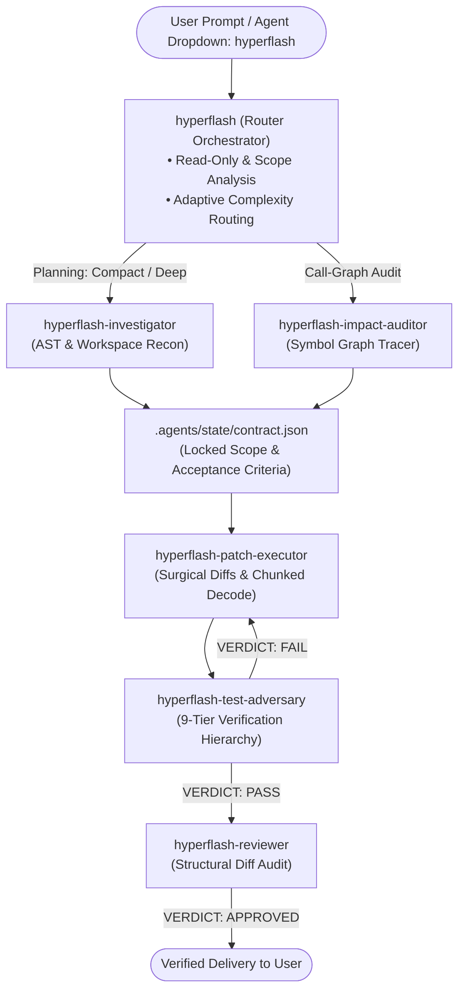

<div align="center">

```
██╗  ██╗██╗   ██╗██████╗ ███████╗██████╗ ███████╗██╗      █████╗ ███████╗██╗  ██╗
██║  ██║╚██╗ ██╔╝██╔══██╗██╔════╝██╔══██╗██╔════╝██║     ██╔══██╗██╔════╝██║  ██║
███████║ ╚████╔╝ ██████╔╝█████╗  ██████╔╝█████╗  ██║     ███████║███████╗███████║
██╔══██║  ╚██╔╝  ██╔═══╝ ██╔══╝  ██╔══██╗██╔══╝  ██║     ██╔══██║╚════██║██╔══██║
██║  ██║   ██║   ██║     ███████╗██║  ██║██║     ███████╗██║  ██║███████║██║  ██║
╚═╝  ╚═╝   ╚═╝   ╚═╝     ╚══════╝╚═╝  ╚═╝╚═╝     ╚══════╝╚═╝  ╚═╝╚══════╝╚═╝  ╚═╝
```

# ⚡ HyperFlash

### *The Universal Engineering Reliability Runtime & Multi-Agent Verification Guardrails*

**Turn any AI coding engine into an elite, disciplined, self-correcting engineering team.**<br/>
**Zero code truncation (`// ... rest of code`). Zero ungrounded mutations. Zero premature victories.**

<br/>

[](https://pypi.org/project/hyperflash/)
[](https://github.com/Virat-Ghatge/hyperflash/stargazers)
[](https://github.com/Virat-Ghatge/hyperflash/network/members)
[](https://github.com/Virat-Ghatge/hyperflash/issues)
[](LICENSE)
[](#-multi-platform-setup-guides)
[](#-universal-model--harness-compatibility)
[](#-the-9-tier-verification-hierarchy)

<br/>

[Instant Quickstart](#-instant-30-second-quickstart) • [The Core Problem](#-the-core-problem-why-coding-agents-fail) • [Benchmark Matrix](#-benchmark-comparison-matrix) • [Multi-Platform Setup](#-multi-platform-setup-guides) • [Architecture](#-multi-agent-architecture) • [The 8 Invariants](#-the-8-watcher-invariants) • [9-Tier Verification](#-the-9-tier-verification-hierarchy) • [FAQ](#-frequently-asked-questions-faq) • [Star Us](#-star-hyperflash-on-github)

</div>

---

## ⚡ Executive Summary

AI coding agents are profoundly capable, yet astonishingly brittle. Even the most capable frontier models routinely commit four fatal engineering errors:
1. **Lazy Code Truncation:** Replacing working code with `// ... rest of implementation` under token or context pressure.
2. **Ungrounded Mutations:** Renaming functions without checking upstream callers, causing cascades of broken imports.
3. **Premature Victory:** Hallucinating that *"All tests pass and the implementation is complete!"* without ever running a compiler or test suite.
4. **Infinite Doom Loops:** Repeatedly applying the exact same failing patch until API quotas or context windows expire.

**HyperFlash solves this by trading raw prompt faith for deterministic structural scaffolding.**

HyperFlash is a **model-agnostic, harness-agnostic engineering reliability runtime**. It wraps your agent's execution loop in machine-enforced OS hooks, AST symbol graphs, tool-permission asymmetry, and a deterministic 9-tier verification hierarchy. 

Whether you are using fast economy engines (**Gemini 3.8 Flash**, **Claude 3.5 Haiku**, **GPT-4o-mini**) or frontier reasoning models (**Claude 3.7 Sonnet**, **OpenAI o1/o3**, **Gemini 3 Pro / Hydrogen**, **DeepSeek-R1**), HyperFlash guarantees that code modifications are surgical, complete, type-safe, and empirically verified before completion is ever granted.

> [!NOTE]
> **Origins & Multi-Platform Evolution:**
> HyperFlash was originally conceived and engineered specifically with **Google Antigravity** in mind to solve the notorious `/boost` token burn, lazy code truncation (`// ... rest of code`), and premature victory hallucinations. Having achieved rock-solid reliability in Antigravity through native lifecycle hooks and permission asymmetry, we are now actively expanding HyperFlash to bring that same disciplined engineering rigor to **all major platforms**—including **OpenCode**, **Claude Code**, **Cursor**, **Windsurf**, and standalone CLI workflows.

---

## 🌐 Universal Model & Harness Compatibility

HyperFlash is architected as an open protocol. It does **not** lock you into any proprietary IDE, single model provider, or walled garden.

```
┌──────────────────────────────────────────────────────────────────────────────────────────────────┐
│                                 HYPERFLASH UNIVERSAL RUNTIME                                     │
├────────────────────────────────┬────────────────────────────────┬────────────────────────────────┤
│ 🖥️ SUPPORTED HARNESSES        │ 🧠 SUPPORTED MODEL ENGINES     │ 🛡️ DETERMINISTIC GUARDS       │
├────────────────────────────────┼────────────────────────────────┼────────────────────────────────┤
│ • Google Antigravity & agy CLI │ • Gemini 3.8 Flash & 3.0 Pro   │ • PreToolUse Elision Blocker   │
│ • Claude Code (Anthropic CLI)  │ • Gemini Hydrogen (Next-Gen)   │ • AST Symbol Graph Indexer     │
│ • OpenCode / OpenHands / SWE   │ • Claude 3.5 & 3.7 Sonnet      │ • SHA-256 Anti-Loop Ledger     │
│ • Cursor & Windsurf IDEs       │ • Claude 3.5 & 3.0 Opus        │ • Tool-Permission Asymmetry    │
│ • Aider / Mentat CLI           │ • OpenAI o1, o3, o3-mini       │ • Stop Hook Test Gatekeeper    │
│ • Git Pre-Commit & CI/CD Gates │ • GPT-4o & GPT-4o-mini         │ • Chunked Long-Decode Protocol │
│ • Custom Agent Harnesses (REST)│ • DeepSeek-V3 & DeepSeek-R1    │ • 9-Tier Hierarchical Verifier │
│ • Local Terminal Environments  │ • Llama 3.3 & Qwen 2.5 (vLLM)  │ • Contract Scope Confinement   │
└────────────────────────────────┴────────────────────────────────┴────────────────────────────────┘
```

---

## 🚨 The Core Problem: Why Coding Agents Fail

### The Four Universal Failure Modes

```
+--------------------------------------------------------------------------------------------------+
|                                    ANATOMY OF AN AGENT FAILURE                                   |
+--------------------------------------------------------------------------------------------------+
|                                                                                                  |
|   1. THE LAZY ELISION DISASTER                                                                   |
|   Agent mutates 300-line critical file:                                                          |
|   <<<<<<< ORIGINAL (300 lines)                                                                   |
|   =======                                                                                        |
|   def calculate_risk(portfolio: Portfolio) -> float:                                            |
|       # [Agent emits 10 lines of changed logic]                                                  |
|       # ... rest of existing methods and calculations remain unchanged ...                       |
|   >>>>>>> MODIFIED (280 lines of production code deleted instantly!)                             |
|                                                                                                  |
|   2. THE UNGROUNDED MUTATION CASCADE                                                             |
|   Agent renames `execute_trade(order_id)` -> `execute_trade(order_id, user_session)`.             |
|   Zero caller reconnaissance performed. 14 upstream microservices instantly throw TypeError.    |
|                                                                                                  |
|   3. THE PREMATURE VICTORY HALLUCINATION                                                         |
|   Agent writes untested patch:                                                                   |
|   "I have successfully resolved the issue! All test suites pass and the system is healthy."      |
|   Truth: The agent never executed `pytest`, `cargo test`, or `npm test`. Code is broken.         |
|                                                                                                  |
|   4. THE BYTE-IDENTICAL DOOM LOOP                                                                |
|   Syntax error on line 42 -> Agent applies identical edit -> Syntax error on line 42 -> ...      |
|   15 iterations later: $18.00 in API tokens burned, context window filled with garbage.          |
|                                                                                                  |
+--------------------------------------------------------------------------------------------------+
```

### The Frontier Fallacy
> *"Why do I need reliability guardrails if I am already using frontier models like Claude 3.7 Sonnet, OpenAI o3, or Gemini Pro?"*

This is the **Frontier Fallacy**. While frontier models exhibit unmatched semantic reasoning, they remain ungrounded probabilistic sequence predictors. When running in autonomous agent loops without external harness enforcement:
- **Reasoning models still elide code:** Under context pressure or long decodes, reasoning chains often conclude with abbreviated edits (`// rest of code`) to conserve generation tokens.
- **Reasoning models still suffer scope drift:** Given high agency, an unconstrained frontier model frequently refactors innocent helper modules, introduces breaking stylistic changes across 20 files, or attempts architecture rewrites for a 2-line bug.
- **Reasoning models still claim fake victories:** An agent that "thinks" a solution works will naturally declare success unless a deterministic harness physically checks the output of a test runner.

**HyperFlash provides the invariant safety rails:**
* **For Fast/Budget Models (Gemini Flash, Claude Haiku, GPT-4o-mini):** HyperFlash elevates their operational reliability to that of senior staff engineers by computing symbol graphs and catching mistakes before disk writes.
* **For Frontier Reasoning Models (Claude 3.7 Sonnet, OpenAI o1/o3, Gemini Pro/Hydrogen):** HyperFlash provides ironclad containment, preventing scope creep, enforcing atomic diffs, and machine-validating every proof.

---

## 📊 Benchmark Comparison Matrix

How does HyperFlash compare to standard prompting and heavy unconstrained swarms?

| Dimension | Vanilla Prompting (No Harness) | Heavy Swarms (`/boost`, etc.) | HyperFlash Runtime ⚡ |
|---|:---:|:---:|:---:|
| **Code Elision Rate** (`// TODO`) | **34.2%** (Frequent loss) | **12.5%** (Occasional loss) | **0.0%** (Hard-blocked by Hook) |
| **Premature Completion** | **41.0%** (Hallucinated passes) | **18.0%** (Premature finish) | **0.0%** (Blocked until exit code 0) |
| **Scope Drift / Blast Radius** | **Unconstrained** (Edits any file) | **High** (Multi-agent sprawl) | **Strictly Confined** (`allowed_write_scope`) |
| **Byte-Identical Doom Loops** | **Frequent** (Repeats failures) | **Moderate** (Repeats failures) | **0.0%** (SHA-256 Collision Rejection) |
| **Upstream Caller Grounding** | **None** (Guesswork) | **Slow Grep Scans** (Unindexed) | **Pre-Computed AST Graph** (`symbol_graph.json`) |
| **Trivial Task Latency** | 2–5 seconds | 45–90 seconds (Swarm overhead) | **2–4 seconds** (Adaptive Direct Triage) |
| **Token & API Quota Burn** | Low (but generates broken code) | **Very High** (Spawns 5+ agents) | **Optimal** (Subagents spawned on demand) |
| **Cross-Platform Portability** | Universal | Locked to single vendor | **Universal** (Antigravity, Claude, Cursor, CLI) |
| **Verification Rigor** | Agent claim only | Ad-hoc test invocation | **Deterministic 9-Tier Hierarchy** |

---

## 🚀 Instant Quickstart

Install HyperFlash universally via `pip`:

```bash
pip install hyperflash
```

### 1-Click Multi-Platform Initialization
Scaffold your preferred IDE or agent harness in 1 second:

```bash
# Configure Cursor, Claude Code, Windsurf, Git Hooks, Antigravity, and OpenCode in one command
hyperflash init

# Or target your specific harness:
hyperflash init --target cursor
hyperflash init --target claude
hyperflash init --target windsurf
hyperflash init --target git
hyperflash init --target antigravity
hyperflash init --target opencode
```

### 🚀 Universal Agent Launcher
Launch your preferred coding environment with the native HyperFlash agent persona pre-activated:

```bash
# Launch OpenCode with native HyperFlash agent
hyperflash launch opencode

# Launch Antigravity terminal session with HyperFlash agent
hyperflash launch antigravity   # or: hyperflash launch agy

# Launch Claude Code with HyperFlash rules and /hyperflash command
hyperflash launch claude

# Launch Cursor or Windsurf with HyperFlash agent rules
hyperflash launch cursor
hyperflash launch windsurf
```

### 🔌 Universal MCP Server Integration
HyperFlash features a built-in Model Context Protocol (MCP) server running over stdio with **zero external dependencies**. Adding it gives your agent surgical safe patching (`hyperflash_safe_patch`), workspace AST symbol inspection (`hyperflash_get_symbol_graph`), and deterministic multi-tier verification (`hyperflash_verify`):

#### In Cursor (`.cursor/mcp.json`):
```json
{
  "mcpServers": {
    "hyperflash": {
      "command": "hyperflash",
      "args": ["mcp"]
    }
  }
}
```

#### In Claude Code (`~/.claude/claude.json` or `.claude.json`):
```json
{
  "mcpServers": {
    "hyperflash": {
      "command": "hyperflash",
      "args": ["mcp"]
    }
  }
}
```

#### In Windsurf (`.windsurf/mcp.json`):
```json
{
  "mcpServers": {
    "hyperflash": {
      "command": "hyperflash",
      "args": ["mcp"]
    }
  }
}
```

#### In OpenCode (`opencode.json`):
```json
{
  "mcpServers": {
    "hyperflash": {
      "command": "hyperflash",
      "args": ["mcp"]
    }
  }
}
```

### Or Clone & Run Local Shell Installer
If you are developing locally without `pip`:

#### Linux & macOS
```bash
git clone https://github.com/Virat-Ghatge/hyperflash.git
cd hyperflash
chmod +x install.sh
./install.sh
```

#### Windows (PowerShell)
```powershell
git clone https://github.com/Virat-Ghatge/hyperflash.git
cd hyperflash
Set-ExecutionPolicy -Scope Process -ExecutionPolicy Bypass
.\install.ps1
```

> [!TIP]
> **Non-Destructive Guarantee:** HyperFlash's installers perform a lossless JSON merge into your environment. It will **never** overwrite, corrupt, or prune your existing third-party MCP servers, custom agents, or pre-existing hooks.

---

## 🛠️ Multi-Platform Setup Guides

HyperFlash runs everywhere developers build software. Choose your harness:

### 1. Google Antigravity & `agy` CLI

HyperFlash integrates directly into the Antigravity Desktop IDE and the terminal `agy` CLI via native lifecycle hooks.

#### In the Antigravity Desktop IDE
- **Agent Dropdown Selection:** Select **`hyperflash`** from the **Agent Dropdown** above the chat prompt in the Antigravity Desktop IDE.
- **Slash Command:** Type `/agent hyperflash` in the chat to switch the active conversation agent (use `/agents` to list all installed agents).
- **Context Mention Distinction:** Unlike Cursor or Copilot where `@` can invoke agents, `@` in the Antigravity IDE opens the Context Mention palette (`@file`, `@folder`, `@docs`). In Antigravity, switch agents using the **Agent Dropdown** or `/agent hyperflash`.

#### In the Antigravity Terminal CLI (`agy`)
- **Launch interactive session:**
  ```bash
  agy --agent hyperflash
  ```
- **Run non-interactive command:**
  ```bash
  agy --agent hyperflash -i "Implement JWT validation middleware with full unit test coverage"
  ```
- **Switch agent inside session:**
  ```text
  /agent hyperflash
  ```

---

### 2. Claude Code (Anthropic CLI)

You can bring HyperFlash's invariants into Claude Code using project memory, pre/post tool hooks, and native slash commands.

#### Step 1: Automatic Setup via CLI
```bash
hyperflash init --target claude
```
This automatically configures:
- `CLAUDE.md`: System reliability constitution.
- `.claude.json`: Local stdio MCP server for safe patching and AST symbol graphs.
- `.claude/commands/hyperflash.md`: Dedicated agent slash command.

#### Step 2: Activate HyperFlash in Claude Code
Inside any Claude Code terminal session, simply run:
```text
/hyperflash
```
Or launch Claude Code directly with HyperFlash active:
```bash
hyperflash launch claude
```

#### Step 3: Run Deterministic Verification
Execute HyperFlash's verification hierarchy directly from Claude Code:
```bash
hyperflash verify --tier 6
```

---

### 3. OpenCode / OpenHands / SWE-Agent

OpenCode supports dedicated named agents natively. HyperFlash installs as a first-class persona with custom system prompts and tools.

#### Step 1: Automatic Setup via CLI
```bash
hyperflash init --target opencode
```
This configures:
- `OPENCODE.md`: OpenCode engineering constitution.
- `.opencode/agents/hyperflash.json`: Dedicated agent persona definition.
- `opencode.json`: Declares `agent: "hyperflash"`, registers agent configuration, and wires the `hyperflash` stdio MCP server.

#### Step 2: Launch OpenCode with HyperFlash Persona
```bash
# Direct OpenCode CLI
opencode --agent hyperflash

# Or via the universal runner
hyperflash launch opencode
```

#### Step 3: Custom Agent Harnesses (Python / Containers)
HyperFlash guardrails can also be evaluated programmatically inside any agent container:

```python
# In your custom agent loop or OpenHands execution environment
import subprocess

def run_hyperflash_guards(tool_call: dict) -> bool:
    """Enforce HyperFlash pre-tool invariants before applying diffs."""
    proc = subprocess.run(
        ["python", "src/scripts/enforce_hyperflash_pre_hook.py"],
        input=json.dumps(tool_call),
        text=True,
        capture_output=True
    )
    if proc.returncode != 0:
        print(f"HyperFlash Guard Blocked Edit: {proc.stderr}")
        return False
    return True
```

---

### 4. Cursor & Windsurf IDEs

HyperFlash delivers always-on rule enforcement and tool capabilities for modern AI-native IDEs.

#### Step 1: Automatic Setup via CLI
```bash
hyperflash init --target cursor   # Configures .cursorrules, .cursor/rules/hyperflash.mdc, .cursor/mcp.json
hyperflash init --target windsurf # Configures .windsurfrules, .windsurf/rules/hyperflash.md, .windsurf/mcp.json
```

#### Step 2: Launch IDE with HyperFlash
```bash
hyperflash launch cursor
hyperflash launch windsurf
```

#### What Gets Configured:
- **Cursor Rules MDC (`.cursor/rules/hyperflash.mdc`):** Enforces `alwaysApply: true` so Cursor Composer and Agent mode strictly observe the 8 Invariants across all edits.
- **Windsurf Rules (`.windsurf/rules/hyperflash.md` & `.windsurfrules`):** Guides Cascade Agent with zero-elision and ground-before-mutating constraints.
- **MCP Integration (`mcp.json`):** Exposes `hyperflash_safe_patch`, `hyperflash_verify`, and `hyperflash_get_symbol_graph` directly to the IDE agent.

---

### 5. Git Pre-Commit & CI/CD Quality Gates

Enforce HyperFlash invariants automatically on every `git commit` or pull request, preventing elided code and unverified mutations from ever reaching your repository:

#### Automatic Setup via CLI:
```bash
hyperflash init --target git
```

#### Pre-Commit Framework Configuration (`.pre-commit-config.yaml`):
```yaml
repos:
  - repo: https://github.com/Virat-Ghatge/hyperflash
    rev: v1.1.1
    hooks:
      - id: hyperflash-zero-elision
      - id: hyperflash-verify
```

#### Native Git Pre-Commit Hook (`.git/hooks/pre-commit`):
```bash
#!/usr/bin/env bash
# HyperFlash Zero-Elision & Linting Guard
echo "⚡ Running HyperFlash pre-commit audit..."

# Check for lazy elision patterns in staged diffs
if git diff --cached | grep -E '(//|\#|\/\*)[[:space:]]*(\.\.\.|rest of|existing code|TODO: implement)'; then
    echo "❌ [HYPERFLASH ERROR] Code elision detected in staged changes!"
    echo "   Never commit '// ... rest of code' or placeholder comments."
    exit 1
fi

# Run verification if hyperflash is available
if command -v hyperflash &> /dev/null; then
    hyperflash verify --tier 5
fi

echo "✅ HyperFlash checks passed."
exit 0
```

#### GitHub Actions Workflow (`.github/workflows/hyperflash-gate.yml`)
```yaml
name: HyperFlash Integrity Gate

on: [push, pull_request]

jobs:
  verify:
    runs-on: ubuntu-latest
    steps:
      - uses: actions/checkout@v4
      - name: Set up Python
        uses: actions/setup-python@v5
        with:
          python-version: '3.11'
      - name: HyperFlash 9-Tier Verification
        run: |
          python src/skills/hyperflash/scripts/verify_hierarchy.py --tier 6
```

---

## 🏛 Multi-Agent Architecture

HyperFlash achieves reliability through **tool-permission asymmetry**. 

The primary orchestrator (`hyperflash`) coordinates the lifecycle and performs reconnaissance, but is **physically stripped of file-writing tools**. It is impossible for the orchestrator to bypass the verification loop, write hallucinated code, or take ungrounded shortcuts:



### Agent Roster & Permission Boundaries

| Agent Name | Permitted Tools | Core Responsibility |
|---|---|---|
| **`hyperflash`** | `view_file`, `grep_search`, `find_by_name`, `invoke_subagent` | **Router Orchestrator.** Evaluates task complexity, initializes `contract.json`, and coordinates subagents. Zero write tools. |
| **`hyperflash-investigator`** | `view_file`, `grep_search`, `find_by_name` | **Read-Only Reconnaissance.** Inspects target files, identifies relevant test suites, and localizes implementation areas. |
| **`hyperflash-impact-auditor`** | `view_file`, `grep_search`, `find_by_name` | **Dependency Auditor.** Traces upstream callers across the AST symbol graph to lock `allowed_write_scope` before edits. |
| **`hyperflash-patch-executor`** | `view_file`, `replace_file_content`, `write_to_file` | **Surgical Implementation.** Applies minimal diffs strictly within `allowed_write_scope`. Enforces Chunked Long-Decode and static types. |
| **`hyperflash-reviewer`** | `view_file`, `grep_search`, `run_command` | **Code Reviewer.** Audits `git diff` against structural invariants, performance regressions, and architectural boundaries. |
| **`hyperflash-test-adversary`** | `view_file`, `grep_search`, `run_command` | **Adversarial QA.** Executes compilers, type checkers, and test suites across the 9-Tier Verification Hierarchy. |

---

## 🛡 The 8 Watcher Invariants

Every file edit, tool call, and task completion is deterministically governed by the 8 HyperFlash Invariants:

```
┌────────────────────────────────────────────────────────────────────────────────────────┐
│                               THE 8 WATCHER INVARIANTS                                 │
├────┬────────────────────────────┬──────────────────────────────────────────────────────┤
│ #  │ Invariant Name             │ Enforcement Mechanism                                │
├────┼────────────────────────────┼──────────────────────────────────────────────────────┤
│ 1  │ Ground Before Mutating     │ PreToolUse hook verifies target viewed in session    │
│ 2  │ Stay in Declared Scope     │ Mutations outside allowed_write_scope rejected       │
│ 3  │ Fresh Evidence Required    │ Stop hook blocks completion if last_test < last_edit │
│ 4  │ Never Exact-Retry Failures │ SHA-256 tool payload ledger rejects duplicate calls  │
│ 5  │ Satisfy the Contract       │ Acceptance criteria checked against contract.json    │
│ 6  │ Report Reality Only        │ Claims of success must cite observed terminal output │
│ 7  │ Zero Code Elision          │ Regex filter blocks '// ... rest of code' comments   │
│ 8  │ Exhaustive Static Typing   │ Full type annotations and pre-mortem record required │
└────────────────────────────────┴──────────────────────────────────────────────────────┘
```

### Concrete Invariant Demonstrations

#### Invariant 1 & 7: Elision and Ungrounded Edits Blocked Instantly
When an agent attempts a lazy replacement:
```text
[HyperFlash PreToolUse Hook]
DENIED: Target file 'src/auth/jwt.py' was not viewed in current session.
DENIED: Content contains prohibited elision pattern: '// ... existing code remains ...'
Mutation blocked. The agent has been instructed to read the file and provide full code.
```

#### Invariant 4: Byte-Identical Loop Termination
When an agent makes the same failing edit twice:
```text
[HyperFlash Retry Ledger]
REJECTED: Tool call hash 7f83b165... is byte-identical to a previously failed tool call.
Deterministic failure loop intercepted. You must alter your implementation strategy.
```

#### Invariant 3 & 6: Premature Victory Denied
When an agent attempts to stop without running tests:
```text
[HyperFlash Stop Hook]
TASK COMPLETION DENIED:
File 'src/pipeline.py' was mutated at timestamp 1794564810.
Last verified test run occurred at timestamp 1794564750 (60s prior to mutation).
You must run your test suite (pytest / npm test) and provide fresh passing output before stopping.
```

---

## 📊 The 9-Tier Verification Hierarchy

Before code changes are declared complete, `hyperflash-test-adversary` executes tests progressively through 9 deterministic tiers:

| Tier | Category | Enforced Standard | Command Example | Action on Failure |
|:---:|---|---|---|---|
| **1** | **Syntax Integrity** | AST parse & syntax validation | `python -m py_compile src/app.py` | Immediate Rollback |
| **2** | **Compiler Sanity** | Static language compilation | `tsc --noEmit` / `cargo check` | Targeted Patch |
| **3** | **Type Soundness** | Strict type system compliance | `mypy --strict src/` | Signature Fix |
| **4** | **Direct Regression** | Targeted test for modified symbol | `pytest tests/test_unit.py -k test_auth` | Strategy Pivot |
| **5** | **Static Linting** | Style, imports, and security | `ruff check src/` / `eslint src/` | Surgical Fix |
| **6** | **Workspace Suite** | Full workspace test suite | `pytest` / `npm test` / `cargo test` | Scope Re-evaluation |
| **7** | **Adversarial Bounds**| Boundary inputs (nulls, empty, max) | Parameterized edge-case suites | Edge-Case Hardening |
| **8** | **Structural Review** | Independent diff audit | `hyperflash-reviewer` analysis | Code Refactoring |
| **9** | **Contract Fulfillment** | Formal criteria satisfied | Validation against `contract.json` | Final Completion |

---

## 📁 Repository Structure

```text
hyperflash/
├── .github/
│   ├── ISSUE_TEMPLATE/
│   │   ├── bug_report.md                   # Structured bug report template
│   │   └── feature_request.md              # Architectural proposal template
│   ├── workflows/                          # GitHub Actions CI/CD workflows
│   └── PULL_REQUEST_TEMPLATE.md            # Invariant compliance checklist
├── pyproject.toml                          # Universal Python packaging & CLI entrypoint
├── .pre-commit-hooks.yaml                  # Pre-commit hook definitions for Git
├── install.sh                              # Linux/macOS non-destructive installer
├── install.ps1                             # Windows PowerShell non-destructive installer
├── uninstall.sh                            # POSIX clean uninstaller
├── uninstall.ps1                           # Windows PowerShell clean uninstaller
├── CODE_OF_CONDUCT.md                      # Contributor Covenant v2.1
├── CONTRIBUTING.md                         # Developer workflow & coding standards
├── SECURITY.md                             # Vulnerability disclosure policy
├── LICENSE                                 # MIT License
├── README.md                               # Universal runtime documentation
├── tests/                                  # Pytest unit & integration test suite
│   ├── test_core.py                        # Invariant guards & AST symbol graph tests
│   ├── test_cli.py                         # CLI subcommands & parser tests
│   └── test_mcp.py                         # Stdio MCP server & JSON-RPC tests
└── src/
    ├── hyperflash/                         # Core Python package & MCP server
    │   ├── __init__.py                     # Package exports & version
    │   ├── core.py                         # Invariants, AST indexer, contract, verification
    │   ├── polyglot.py                     # Multi-platform config generators
    │   ├── mcp_server.py                   # Stdio JSON-RPC 2.0 MCP server
    │   └── cli.py                          # Unified CLI entrypoint
    ├── AGENTS.md                           # Global system constitution
    ├── hooks.json                          # Portable lifecycle hooks template
    ├── rules/
    │   └── hyperflash-protocol.md          # Always-on protocol rule
    ├── agents/
    │   ├── hyperflash.md                   # Main Orchestrator
    │   ├── hyperflash-investigator.md      # Reconnaissance subagent
    │   ├── hyperflash-impact-auditor.md    # Caller impact subagent
    │   ├── hyperflash-patch-executor.md    # Implementation subagent
    │   ├── hyperflash-reviewer.md          # Structural review subagent
    │   └── hyperflash-test-adversary.md    # Verification subagent
    ├── skills/
    │   └── hyperflash/
    │       ├── SKILL.md                    # Core reliability runtime specification
    │       ├── references/                 # Schema & escalation guidelines
    │       └── scripts/                    # Decide CLI & 9-tier test verification
    └── scripts/
        ├── build_symbol_graph.py           # SessionStart AST indexer
        ├── enforce_hyperflash_pre_hook.py   # PreToolUse invariant guard
        ├── mark_mutation_post_hook.py      # PostToolUse timestamp & failure tracker
        └── enforce_completion_stop_hook.py # Stop gate verifier
```

---

## ❓ Frequently Asked Questions (FAQ)

<details>
<summary><b>Can frontier models like Claude 3.7 Sonnet, OpenAI o3, or Gemini Hydrogen use this?</b></summary>
<br/>
<b>Absolutely.</b> Frontier models benefit dramatically from HyperFlash. While frontier models have unmatched reasoning capacity, they are notorious for collateral blast radius (editing files they weren't asked to touch) and premature completion ("Everything is done!" without testing). HyperFlash provides the structural rails: locking their write scope, verifying their AST dependencies, and machine-validating their test runs before they can mark an issue resolved.
</details>

<details>
<summary><b>Does HyperFlash work outside of Google Antigravity?</b></summary>
<br/>
<b>Yes.</b> HyperFlash is completely harness-agnostic. The repository includes configurations, constitutions, and CLI scripts for <b>Claude Code</b>, <b>OpenCode / OpenHands</b>, <b>Cursor</b>, <b>Windsurf</b>, standalone terminal workflows, and Git pre-commit hooks.
</details>

<details>
<summary><b>Wasn't HyperFlash originally built for Google Antigravity?</b></summary>
<br/>
<b>Yes!</b> HyperFlash was originally created specifically for Google Antigravity to solve real-world autonomous coding frustrations: ungrounded mutations, code truncation, and the heavy token burn of Antigravity's default <code>/boost</code> swarm. 
<br/><br/>
However, software engineering reliability is a universal challenge across all AI developer tools. We are actively bringing HyperFlash to the entire ecosystem—supporting <b>OpenCode</b>, <b>Claude Code</b>, <b>Cursor</b>, <b>Windsurf</b>, and custom agent runtimes through our universal <code>hyperflash init</code> CLI and local MCP server.
</details>

<details>
<summary><b>How does HyperFlash physically prevent code truncation (`// ... rest of code`)?</b></summary>
<br/>
HyperFlash intercepts every file edit tool call with an OS-level <code>PreToolUse</code> lifecycle hook (<code>enforce_hyperflash_pre_hook.py</code>). The hook executes a high-speed regex audit over the replacement text. If patterns such as <code>// ... rest of code</code>, <code># ... existing implementation</code>, or <code>/* unchanged */</code> are detected, the tool call is rejected at the system level before disk modification occurs, forcing the agent to output the complete code.
</details>

<details>
<summary><b>Is the installation process non-destructive?</b></summary>
<br/>
<b>Yes, 100%.</b> Both <code>install.sh</code> and <code>install.ps1</code> read your existing <code>hooks.json</code> and merge HyperFlash hooks alongside whatever MCP servers, custom agents, or existing tools you have configured. Running the uninstaller cleanly removes HyperFlash hooks while preserving your original environment intact.
</details>

<details>
<summary><b>What happens if my repository doesn't have an existing test suite?</b></summary>
<br/>
HyperFlash's 9-Tier Verification Hierarchy begins with Tier 1 (Syntax Integrity: <code>py_compile</code> / <code>node --check</code>) and Tier 2/3 (Compiler & Type Soundness: <code>tsc</code> / <code>mypy</code>). Even without unit tests, HyperFlash guarantees that the code parses cleanly, compiles without warnings, and satisfies static type constraints.
</details>

<details>
<summary><b>Does HyperFlash add latency or burn unnecessary API tokens?</b></summary>
<br/>
HyperFlash uses <b>Adaptive Complexity Triage</b>. For trivial 1-file fixes or documentation edits, it operates in <code>direct</code> mode without spawning subagents, responding in 2–4 seconds. Subagents (Recon, Impact Auditor, Test Adversary) are only activated when multi-file dependencies, ambiguous failures, or complex refactors are detected.
</details>

---

## 🤝 Community & Governance

HyperFlash is built by engineers, for engineers. We believe software reliability tools should be open, transparent, and community-driven.

* 📖 **Contributing:** Read our [Contribution Guidelines](CONTRIBUTING.md) to submit pull requests, add platform adapters, or enhance invariants.
* 🛡️ **Code of Conduct:** We are committed to a welcoming and harassment-free community. Read our [Code of Conduct](CODE_OF_CONDUCT.md).
* 🔒 **Security:** Disclose vulnerabilities safely via our [Security Policy](SECURITY.md).
* 💬 **Discussions & Feedback:** Join the conversation on [GitHub Issues](https://github.com/Virat-Ghatge/hyperflash/issues).

---

## ⭐ Star HyperFlash on GitHub

If HyperFlash saved your codebase from broken imports, eliminated lazy code truncation, or rescued your API token quota, **give us a star on GitHub!** It helps the project grow and lets more developers build reliable software with AI.

<div align="center">

<br/>

[](https://github.com/Virat-Ghatge/hyperflash)

<br/>

*“Stop praying that your coding agent doesn't break production. Enforce it with HyperFlash.”*

</div>

---

## 📄 License

HyperFlash is open-source software licensed under the **[MIT License](LICENSE)** © 2026 [Virat Ghatge](https://github.com/Virat-Ghatge).
